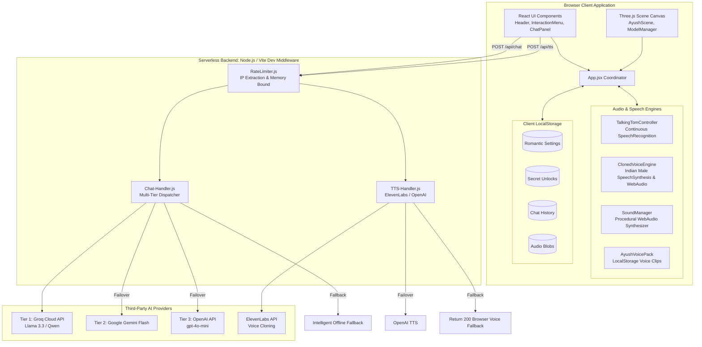
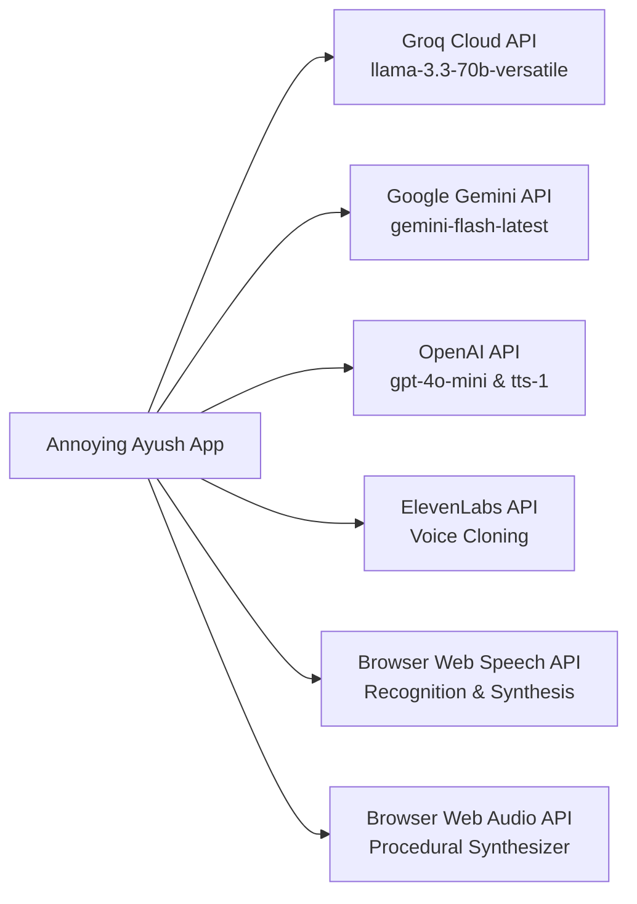
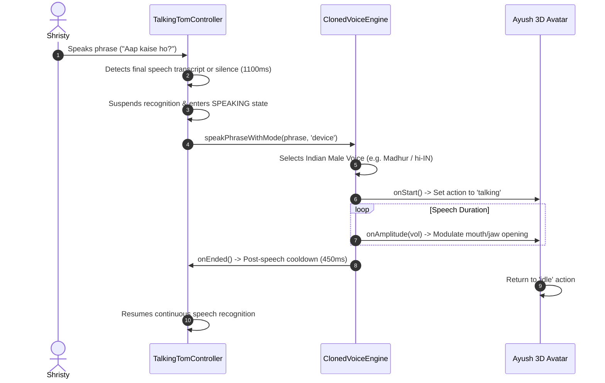
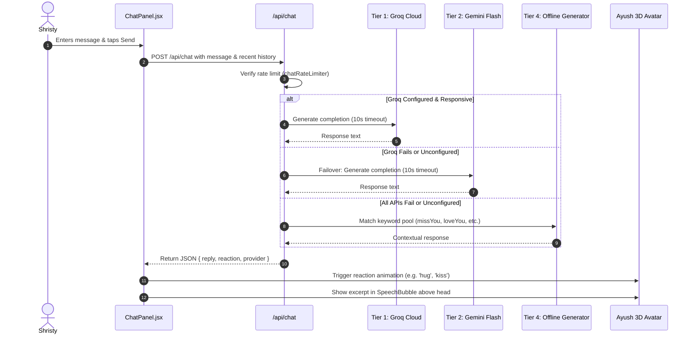

# BRAIN.md — Annoying Ayush Technical Knowledge Base

> **Central Architecture, Design System, API Documentation, and Implementation Specification**  
> *Last Verified against Codebase: October 2026 | Test Suite Passing: 108 / 108 Tests (0 Lint Errors)*

---

## 1. Project Overview

**Annoying Ayush** (`annoying-ayush`) is a mobile-first, romantic 3D interactive web game inspired by interactive pet gameplay (*Talking Tom*), created as a private, long-distance relationship gift by Ayush for his girlfriend, Shristy.

The application blends:
- A high-framerate 3D rendering pipeline powered by Three.js and React Three Fiber.
- Multi-zone touch hitboxes supporting tap, multi-tap annoyance escalation, and long-press hugs.
- Real-time procedural audio synthesis using the Web Audio API without external audio file dependencies.
- Hands-free, continuous Talking Tom-style voice repetition utilizing speech recognition and a dedicated Free Indian Male Voice Engine.
- Multi-tier conversational AI failover (Groq Cloud -> Google Gemini -> OpenAI -> Contextual Intelligent Offline Fallback).
- 100% private client-side persistence in browser `localStorage`.
- Romantic Easter-egg unlock mechanisms including secret 5-tap heart detection and a 3-step action combo sequence that opens a personalized, wax-sealed love letter.

---

## 2. Project Vision and Goals

1. **Private Relationship Companion**: A low-friction, deeply personalized pocket avatar for Shristy to interact with Ayush whenever she misses him or wants comfort.
2. **Zero-Cost, High-Reliability Architecture**: Operates 100% free of recurring infrastructure fees. Uses free AI tiers (Groq/Google Gemini), local browser Web Speech synthesis, procedural Web Audio generation, and client-side storage.
3. **Frictionless Mobile UX**: Designed mobile-first with safe-area insets, 44px minimum touch targets (WCAG 2.2 AA compliant), continuous hands-free voice repetition without push-to-talk fatigue, and intelligent offline fallbacks that ensure the app never fails or displays technical error screens.
4. **Emotional & Playful Aesthetics**: Soft pastel aesthetic (Love Letter design system) featuring blush pinks, warm cream tones, studio mat podium, floating particles, and heart bursts.

---

## 3. Technology Stack

### Core Runtime & Build Tools
| Technology | Version | Purpose |
| :--- | :--- | :--- |
| **Node.js** | `>=18.0.0` | Server runtime & test runner |
| **React** | `^19.2.8` | UI Component Framework |
| **React DOM** | `^19.2.8` | DOM Renderer for React |
| **Vite** | `^8.3.0` | Development Server & Production Bundler |
| **@vitejs/plugin-react**| `^6.1.1` | React Fast Refresh & JSX Transformation |
| **Oxlint** | `^1.81.0` | High-performance Rust-based linter |
| **Vercel Serverless** | Node.js Runtime | Serverless backend execution for `/api/*` |

### 3D Graphics & Animation
| Library | Version | Purpose |
| :--- | :--- | :--- |
| **Three.js** | `^0.186.1` | 3D WebGL Library |
| **@react-three/fiber** | `^9.8.2` | React reconciler for Three.js |
| **@react-three/drei** | `^10.7.9` | Three.js helpers (OrbitControls, ContactShadows, useGLTF) |
| **three-stdlib** | Transitive | `SkeletonUtils` for SkinnedMesh skeleton cloning |

### Audio, Speech & UI Utilities
| Library | Version | Purpose |
| :--- | :--- | :--- |
| **Web Audio API** | Native Browser | Algorithmic sound effects, analyser node for lip sync |
| **Web Speech API** | Native Browser | SpeechRecognition (listening) & SpeechSynthesis (repeating) |
| **MediaRecorder API**| Native Browser | Voice recording for real custom voice packs |
| **lucide-react** | `^1.59.0` | Cohesive modern icon set |
| **canvas-confetti** | `^1.9.4` | Romantic celebration particles on secret unlock |

---

## 4. Complete Project Directory Structure

```text
Annoying Ayush/
├── .env.example                     # Reference template for server environment variables
├── .env.local                       # Local server-side secret API keys (git-ignored)
├── .gitignore                       # Git exclusions (node_modules, dist, .env.local)
├── .oxlintrc.json                   # Oxlint linting configuration
├── README.md                        # Project documentation and milestone summaries
├── vercel.json                      # Vercel deployment configuration (15s maxDuration)
├── vite.config.js                   # Vite configuration with embedded dev API middleware
├── index.html                       # HTML5 entry with accessible mobile viewport config
├── package.json                     # Dependency manifests and npm scripts
├── package-lock.json                # Deterministic dependency lockfile
├── api/                             # Serverless backend endpoints
│   ├── chat-handler.js              # Multi-tier AI chat handler (Groq/Gemini/OpenAI/Fallback)
│   ├── chat.js                      # Vercel serverless entry for /api/chat
│   ├── rateLimiter.js               # Bounded in-memory sliding-window rate limiter
│   ├── tts-handler.js               # Server-side TTS generation (ElevenLabs/OpenAI)
│   └── tts.js                       # Vercel serverless entry for /api/tts
├── public/                          # Static assets served at root
│   ├── favicon.svg                  # Heart-shaped browser favicon
│   ├── icons.svg                    # SVG icon sprites
│   ├── audio/                       # Static audio assets directory
│   │   └── ayush/
│   │       └── README.md            # Guidelines for static voice pack clips
│   └── models/                      # 3D model assets
│       ├── README.md                # 3D model loading guidelines & specifications
│       └── ayush.glb                # Custom 3D rigged character avatar
├── src/                             # Frontend application source code
│   ├── App.css                      # App shell supplementary styling
│   ├── App.jsx                      # Root application component and coordinator
│   ├── index.css                    # Complete Love Letter Design System (~2,700 lines)
│   ├── main.jsx                     # React DOM client mounting entry
│   ├── assets/                      # Bundled frontend image assets
│   │   ├── hero.png                 # Hero illustration
│   │   ├── react.svg                # React logo asset
│   │   └── vite.svg                 # Vite logo asset
│   ├── components/                  # React UI & 3D scene components
│   │   ├── AyushCharacter.jsx       # Procedural 3D chibi avatar with 9 animations
│   │   ├── AyushModelManager.jsx    # Model selector (custom GLB vs procedural chibi)
│   │   ├── AyushScene.jsx           # R3F Canvas, studio lighting, camera controller
│   │   ├── ChatPanel.jsx            # Sliding AI romantic chat panel
│   │   ├── CustomAyushModel.jsx     # Rigged GLTF/GLB loader with bone/jaw lip-sync
│   │   ├── FloatingHearts.jsx       # 3D instanced floating heart particles
│   │   ├── Header.jsx               # Header with mic pill, secret heart tap, days together
│   │   ├── InteractionMenu.jsx      # Navigation tabs (Play & Romance, AI Chat) & action buttons
│   │   ├── RomanticSettingsModal.jsx# Personalization modal (names, anniversary, voice pack)
│   │   ├── SecretLetterModal.jsx    # Wax-sealed romantic love letter modal
│   │   ├── SpeechBubble.jsx         # Non-obtrusive top speech toast above 3D character
│   │   └── VoicePanel.jsx           # Voice testing and manual speech controls
│   └── utils/                       # Business logic, audio engines, and data managers
│       ├── aiPersonality.js         # Offline romantic fallback matching and reaction detection
│       ├── audioEffects.js          # Web Audio procedural sound synthesizer (pops, boings, kisses)
│       ├── ayushVoicePack.js        # Real custom voice pack recording & playback manager
│       ├── chatStorage.js           # LocalStorage chat history persistence
│       ├── clonedVoiceEngine.js     # Indian male speech synthesis & audio buffer decoder
│       ├── dialoguePools.js         # 15 categorized romantic dialogues & time greetings
│       ├── romanticSettings.js      # Settings storage, model URL validator, anniversary logic
│       ├── speechTranscriber.js     # Single-turn speech recognition utility
│       ├── talkingTomController.js  # Hands-free continuous listening controller
│       └── voiceRecorder.js         # Pitch-shifted chipmunk audio recorder engine
└── test/                            # Node.js automated test suites (90 tests)
    ├── accessibility.test.js        # Viewport zoom accessibility and font size checks
    ├── ayushVoicePack.test.js       # Real voice pack storage and playback tests
    ├── chatHandler.test.js          # Chat API HTTP validation and fallback tests
    ├── continuousListening.test.js  # Talking Tom continuous speech lifecycle tests
    ├── minimalTalkingTomUi.test.js  # UI simplicity, camera bounds, and framing tests
    ├── rateLimiter.test.js          # Bounded rate limiting and IP extraction tests
    ├── romanticSettings.test.js     # Model URL validation and settings storage tests
    ├── ttsDeadlines.test.js         # TTS server/client deadlines and cancellation tests
    └── voiceModesAndInteractions.test.js # Voice mode dispatching and gesture tests
```

---

## 5. System Architecture



---

## 6. Frontend Architecture

### Component Hierarchy
```text
App.jsx (Root Coordinator)
├── Header.jsx (Title, 5-Tap Secret Heart, Mic Status Pill, Settings Button, Info Dialog)
├── SpeechBubble.jsx (Top-Anchored Non-Obtrusive Dialogue Toast)
├── AyushScene.jsx (Canvas, Lights, Stage, OrbitControls)
│   ├── FaceFocusedCameraController (Dynamic camera target lerp on zoom)
│   ├── StudioStage (Pastel podium cylinder, accent ring, contact shadows)
│   ├── FloatingParticles (Ambient pastel orbiting particles)
│   ├── FloatingHearts (Instanced heart particles on romance actions)
│   └── AyushModelManager (Probes /models/ayush.glb vs custom URL)
│       ├── CustomAyushModel.jsx (Rigged GLB SkinnedMesh + bones + jaw lip-sync)
│       └── AyushCharacter.jsx (Procedural chibi avatar fallback)
├── InteractionMenu.jsx (2 Primary Tabs: "Play & Romance" vs "AI Chat")
│   ├── Action Buttons Grid (Kiss, Hug, Blush, Cuddle, Tease, Love Note)
│   └── ChatPanel.jsx (Sliding AI Chat Interface, messages, quick emojis)
├── RomanticSettingsModal.jsx (Names, anniversary date, voice pack recording)
└── SecretLetterModal.jsx (Wax-sealed romantic modal on secret discovery)
```

### 3D Rendering & Camera System
1. **Prominent Framing**: Camera initialized at `position: [0, 0.38, 3.24]`, `fov: 44`. Character fills 83% of the viewport height with generous headroom above the hair to prevent mobile clipping.
2. **Face-Focused Dynamic Zoom**: As the user pinches or scrolls to zoom in from distance `3.24` down to `1.5`, `FaceFocusedCameraController` interpolates `controls.target.y` from `0.38` up to `0.98` (face level) while adjusting `camera.position.y` concurrently, preventing camera drift and fighting with OrbitControls.
3. **Procedural Chibi vs Skinned GLB**:
   - `AyushCharacter.jsx`: Fully procedural meshes (sphere head, hoodie torso, jeans legs, shoes) with independent eye saccades, randomized blinking, and 9 expressive animation states (`idle`, `talking`, `surprised`, `annoyed`, `blush`, `kiss`, `hug`, `dance`, `boop`).
   - `CustomAyushModel.jsx`: Cloned via `SkeletonUtils.clone` to preserve skeleton bone deformation. Arms are anchored in a relaxed hanging pose beside the torso; jaw bone and morph targets are animated in real-time by audio amplitude.

---

## 7. Backend Architecture

### Serverless Endpoints
All backend logic resides in the `/api` directory. In local development, `vite.config.js` injects the `apiDevServerPlugin` middleware to execute `/api/chat` and `/api/tts` identically to Vercel production serverless functions.

### Execution Flow & Coordinated Deadlines
- **Overall Function Deadline**: Vercel functions are bounded by `maxDuration: 15` in `vercel.json`.
- **Server Internal Deadline**: `SERVER_TOTAL_DEADLINE_MS = 14000` (14s) ensures upstream requests abort before the platform terminates the container.
- **Client Timeout**: Client fetch requests timeout at 17s (`AbortSignal.timeout(17000)`), accommodating network latency after server generation completes.
- **Failover Chain for Chat**:
  1. Groq Cloud (Ultra-fast, Llama/Qwen) — 10s timeout
  2. Google Gemini Flash — 10s timeout
  3. OpenAI (`gpt-4o-mini`) — 10s timeout
  4. Server-Side Contextual Fallback — 0ms (Guarantees HTTP 200 response with romantic reply)

---

## 8. Database & Storage Architecture

The application uses **zero remote databases** to ensure 100% privacy and zero hosting fees. All data is persisted in browser `localStorage`.

### LocalStorage Schema Reference

| Storage Key | Type | Description & Sanitization |
| :--- | :--- | :--- |
| `annoying_ayush_romantic_settings_v1` | `JSON Object` | Stores `gfName`, `ayushName`, `anniversaryDate`, `soundEnabled`, `romanticMessagesEnabled`, `floatingEffectsEnabled`, `customModelUrl`, `voiceMode`, `recognitionLanguage`. Rejects ephemeral `blob:` URLs and dangerous URI schemes. |
| `annoying_ayush_unlocks_v1` | `JSON Object` | Stores `{ secretHeartUnlocked: bool, comboUnlocked: bool, heartTapCount: number, totalKisses: number, totalHugs: number }`. |
| `annoying_ayush_chat_history_v1` | `JSON Array` | Bounded array (last 50 messages) of `{ id, sender, text, timestamp, isOfflineFallback }`. |
| `annoying_ayush_real_voice_<actionId>` | `String (Data URL)` | Base64-encoded audio blob (`data:audio/webm;base64,...`) for actions: `kiss`, `hug`, `blush`, `cuddle`, `laugh`, `loveNote`. |
| `ayush_continuous_listening_opted_in` | `String` | `'true'` or `'false'`. Indicates whether the user consented to hands-free continuous listening. |

---

## 9. API Documentation

### 1. AI Chat Endpoint: `/api/chat`

#### `GET /api/chat`
Returns API readiness and configured provider status.
- **Response `200 OK`**:
```json
{
  "ok": true,
  "status": "live",
  "configured": true,
  "provider": "groq"
}
```

#### `POST /api/chat`
Dispatches a romantic conversation turn through the multi-tier failover engine.
- **Headers**: `Content-Type: application/json`
- **Rate Limit**: 25 requests / minute per client IP.
- **Request Body**:
```json
{
  "message": "I miss you so much today!",
  "gfName": "Shristy",
  "ayushName": "Ayush",
  "history": [
    { "role": "user", "content": "Hey Ayush!" },
    { "role": "assistant", "content": "Hey my favorite girl! ❤️" }
  ]
}
```
- **Validation**:
  - `message`: Required non-empty string, trimmed, capped at 500 characters.
  - `history`: Optional array, bounded to the most recent 8 messages, max 500 characters per message.
- **Response `200 OK`**:
```json
{
  "ok": true,
  "configured": true,
  "reply": "Aww, come here 🥺 Sending you the biggest virtual hug until I can annoy you in person!",
  "reaction": "hug",
  "provider": "groq",
  "isOfflineFallback": false
}
```
- **Error Responses**:
  - `400 Bad Request`: `{ "ok": false, "error": "Message cannot be empty." }`
  - `405 Method Not Allowed`: `{ "ok": false, "error": "Method Not Allowed" }`
  - `429 Too Many Requests`: `{ "ok": false, "error": "Too many requests. Please pause for a moment.", "rateLimited": true }`
  - `503 Service Unavailable`: `{ "ok": false, "error": "Service temporarily at capacity. Please try again shortly." }`

---

### 2. Cloned Voice / TTS Endpoint: `/api/tts`

#### `GET /api/tts`
Probes voice synthesis readiness.
- **Response `200 OK`**:
```json
{
  "ok": true,
  "status": "ready",
  "configured": true,
  "hasElevenLabs": true,
  "hasOpenAI": false,
  "voiceProvider": "elevenlabs",
  "modelId": "eleven_multilingual_v2"
}
```

#### `POST /api/tts`
Generates binary speech audio for an utterance.
- **Headers**: `Content-Type: application/json`
- **Rate Limit**: 20 requests / minute per client IP.
- **Request Body**:
```json
{
  "text": "Hey Shristy, you are my favorite person in the world!"
}
```
- **Response `200 OK` (Audio Generated)**:
  - `Content-Type`: `audio/mpeg`
  - `Body`: Binary MP3 buffer
- **Response `200 OK` (Fallback to Browser Voice)**:
```json
{
  "ok": false,
  "configured": false,
  "message": "ELEVENLABS_API_KEY and ELEVENLABS_VOICE_ID are not set on server. Using browser voice fallback.",
  "text": "Hey Shristy, you are my favorite person in the world!"
}
```

---

## 10. Authentication and Authorization

- **Client Authorization**: No user passwords or login sessions. Access is open for Shristy on her personal device.
- **Secret Key Protection**: All AI provider API keys (`GROQ_API_KEY`, `GEMINI_API_KEY`, `OPENAI_API_KEY`, `ELEVENLABS_API_KEY`) are read strictly via server-side `process.env`. Never prefixed with `VITE_` or bundled into browser code.
- **IP Extraction**: [rateLimiter.js](file:///c:/Users/akm45/OneDrive/Desktop/Game%20Dev/Annoying%20Ayush/api/rateLimiter.js) extracts the client IP using trusted platform headers (`x-real-ip` injected by Vercel edge proxy), falling back to `x-forwarded-for` and socket addresses.
- **In-Game Secret Authorization**: Unlocking the secret love letter requires either solving the 5-tap heart pattern or executing the 3-action sequence (`Kiss` -> `Hug` -> `Blush`).

---

## 11. Third-Party Integrations



1. **Groq Cloud API**: Primary ultra-low-latency LLM inference provider (Free Tier, Llama 3.3 70B / Qwen 2.5 32B).
2. **Google Gemini API**: Secondary failover LLM provider (Free Tier via Google AI Studio).
3. **OpenAI API**: Tertiary failover LLM provider and secondary TTS provider (`tts-1`).
4. **ElevenLabs**: Primary voice cloning service using authorized custom voice IDs.
5. **Browser Native Web Speech API**: Client-side speech recognition (`webkitSpeechRecognition`) and Indian English/Hindi voice synthesis.

---

## 12. Environment Variables & Configuration

The application uses server-side environment variables loaded in `vite.config.js` for local development and configured via the Vercel Dashboard for production.

| Variable Name | Required | Default Value | Description |
| :--- | :--- | :--- | :--- |
| `GROQ_API_KEY` | Optional | None | Free Groq Cloud API key for ultra-fast chat |
| `GROQ_MODEL` | Optional | `qwen/qwen3.8-27b` | Override model for Groq completions |
| `GEMINI_API_KEY` | Optional | None | Google AI Studio Gemini API key |
| `GEMINI_MODEL` | Optional | `gemini-flash-latest` | Override model for Gemini completions |
| `OPENAI_API_KEY` | Optional | None | OpenAI API key for chat or TTS failover |
| `OPENAI_MODEL` | Optional | `gpt-4o-mini` | Override model for OpenAI chat completions |
| `OPENAI_BASE_URL` | Optional | `https://api.openai.com/v1` | Custom endpoint for OpenRouter/compatible proxies |
| `ELEVENLABS_API_KEY` | Optional | None | ElevenLabs secret API key |
| `ELEVENLABS_VOICE_ID`| Optional | None | Custom voice ID for Ayush's cloned voice |
| `ELEVENLABS_MODEL_ID`| Optional | `eleven_multilingual_v2` | Model ID for ElevenLabs speech generation |
| `OPENAI_TTS_MODEL` | Optional | `tts-1` | OpenAI TTS model |
| `OPENAI_TTS_VOICE` | Optional | `echo` | OpenAI voice tone |

> **Security Rule**: Never check `.env.local` or real API keys into git. `.env.example` serves as the safe template.

---

## 13. Core Features & Implementation Status

| Feature | Status | Primary Source Files | Internal Mechanism |
| :--- | :--- | :--- | :--- |
| **3D Procedural Chibi Avatar** | Implemented | `AyushCharacter.jsx` | Procedural geometries, breathing cycle, eye saccades, natural blinking, 9 reaction animations, amplitude-driven lip-sync. |
| **Rigged GLB Avatar Loader** | Implemented | `CustomAyushModel.jsx` | `SkeletonUtils.clone()`, auto-scaling to 2.18 units, podium anchoring at y=-0.88, resting arm pose, jaw/morph lip-sync. |
| **Touch Zone Reactions** | Implemented | `AyushCharacter.jsx`, `App.jsx` | Forehead bonk, cheek blush, nose boop, torso bounce, 500ms longpress hug. |
| **Annoyance Scaling** | Implemented | `App.jsx` | Rapid taps (>=5) trigger mock-annoyed pout reaction; stopping after >=3 taps triggers affectionate dialogue. |
| **Face-Focused Camera** | Implemented | `AyushScene.jsx` | Dynamic camera target lerp (`0.38` -> `0.98`) during zoom without OrbitControls jitter. |
| **Procedural Audio Synthesizer**| Implemented | `audioEffects.js` | Web Audio oscillator ramps for pop, boing, boop, kiss, purr, giggle, fanfare, and shy chimes. |
| **Hands-Free Talking Tom** | Implemented | `talkingTomController.js` | Continuous SpeechRecognition with mutual audio exclusion, silence timeout, and loop prevention. |
| **Free Indian Male Voice Engine**| Implemented | `clonedVoiceEngine.js` | Prioritizes Indian male voices (`Madhur`, `Prabhat`, `Ravi`, `hi-IN`, `en-IN`), strong GC reference, watchdog timer. |
| **Multi-Tier AI Chat** | Implemented | `chat-handler.js`, `ChatPanel.jsx` | Groq -> Gemini -> OpenAI -> Contextual Offline Fallback with character reaction inference. |
| **Offline Fallback Matching** | Implemented | `aiPersonality.js`, `dialoguePools.js` | 8 keyword categories (miss you, love, annoying, sad/stressed, greetings) delivering formatted responses. |
| **Relationship Personalization**| Implemented | `RomanticSettingsModal.jsx` | Local storage management for names, anniversary date, model URL, audio toggles. |
| **Secret 5-Tap Heart Unlock** | Implemented | `Header.jsx`, `SecretLetterModal.jsx` | 5 taps within 3.5s triggers fanfare, confetti, and reveals the romantic letter. |
| **Secret Combo Sequence** | Implemented | `App.jsx`, `SecretLetterModal.jsx` | Executing `Kiss` -> `Hug` -> `Blush` unlocks the romantic letter. |
| **Real Voice Pack Recording** | Implemented | `ayushVoicePack.js`, `RomanticSettingsModal.jsx` | In-browser MediaRecorder captures audio blobs saved to `localStorage` per action. |
| **Serverless Rate Limiter** | Implemented | `rateLimiter.js` | Sliding-window in-memory limiter with strict capacity rejection (503) and expired entry pruning. |
| **Coordinated Server TTS** | Implemented | `tts-handler.js` | ElevenLabs with OpenAI failover within strict 14s deadline. |
| **Eight Playable Mini-Games** | Implemented | `ActivityHub.jsx`, `activities/*` | Tap Challenge, Memory Match, Reaction Speed, Dance Copy, Bubble Pop, Rock-Paper-Scissors, Guess the Sound, Quick Quiz with reward economy. |
| **Wardrobe & 3D Accessories** | Implemented | `WardrobePanel.jsx`, `WardrobeAccessories3D.jsx` | Hats (Crown, Blossom, Party, Cap, Beanie), Glasses (Heart, Wayfarer), Outfits, Accessories rendered in 3D. |
| **Room Themes & Atmospheres** | Implemented | `RoomPanel.jsx`, `RoomEnvironment.jsx` | 3D room backdrops (Studio, Sunset, Night Sky, Rose Garden) with matching lighting presets. |
| **Player Progression & Economy** | Implemented | `progressionStorage.js`, `Header.jsx`, `ProfilePanel.jsx` | Coins, level, XP, affection meter, 9 achievements, and 24-hr non-punitive daily gift claim. |

---

## 14. User Flows & Application Workflows

### 1. Hands-Free Talking Tom Speech Repetition Loop


### 2. Multi-Tier AI Chat Workflow


---

## 15. State Management

The application uses React's native state primitives with explicit state colocation:

1. **`App.jsx`**: Coordinates global animation action (`currentAction`), dialogue text (`speechText`), listening status (`listeningState`), heart burst triggers (`heartBurst`), annoyance count, and active modal dialogs.
2. **Persistent Singletons**:
   - `talkingTomController`: Manages continuous SpeechRecognition session generations, silence timers, and restart backoffs.
   - `clonedVoiceEngine`: Controls AudioContext unlocking, SpeechSynthesis utterance references, and amplitude sampling.
   - `soundManager`: AudioContext oscillator synthesizer with mute state synced to romantic settings.
   - `ayushVoicePack`: In-memory and `localStorage` cache of custom voice recordings.
3. **No Heavy External State Libraries**: State flows cleanly via props and callbacks without Redux or Zustand, maintaining a minimal JavaScript footprint.

---

## 16. Error Handling & Logging

1. **Model Loading Failure**: `ModelErrorBoundary` in `AyushModelManager.jsx` catches network or parsing errors on custom GLB models and falls back seamlessly to the procedural `AyushCharacter` without breaking the scene.
2. **Microphone Errors**:
   - `not-allowed`: Displays instructional pill for Android Chrome permissions without entering a rapid restart loop.
   - `no-speech` / `audio-capture`: Handled gracefully with bounded exponential backoff.
3. **SpeechSynthesis Garbage Collection**: On mobile Android Chrome, `SpeechSynthesisUtterance` can be prematurely garbage collected by V8 mid-sentence. `clonedVoiceEngine.js` retains a strong reference on `this.activeUtterance` and runs an active watchdog timer to ensure clean completion.
4. **Diagnostic Logging**: `logVoiceDiagnostic()` outputs structured diagnostic events in development mode (`import.meta.env.DEV`) while suppressing logs in production and automated test runs.

---

## 17. Security Architecture

1. **Zero Secret Leakage**:
   - Vite environment variables prefixed with `VITE_` are bundled into client assets. Therefore, **no secret API keys use the `VITE_` prefix**.
   - All external API calls (Groq, Gemini, OpenAI, ElevenLabs) are mediated exclusively by `/api/*` serverless handlers.
2. **Input Validation**:
   - Chat messages capped at 500 characters.
   - Conversation history capped at 8 turns.
   - Partner names capped at 30 characters.
3. **Model URL Sanitization**:
   - `validateAndNormalizeModelUrl()` in `romanticSettings.js` blocks `javascript:`, `vbscript:`, `data:`, and ephemeral `blob:` URLs.
4. **Bounded Rate Limiting**:
   - Chat: 25 req/min per IP.
   - TTS: 20 req/min per IP.
   - Memory-bounded to 1,000 active client records with automatic expired window pruning and HTTP 503 capacity rejection.

---

## 18. Performance Optimization

1. **Zero Asset Weight for SFX**: All UI and character sound effects (pops, boings, kisses, sparkles) are generated algorithmically using Web Audio API oscillators and gain nodes.
2. **Frame-Rate Independent Animation**: 3D character animations and camera controllers use Three.js `delta` time with `THREE.MathUtils.damp` to ensure smooth 60fps execution on 60Hz, 90Hz, and 120Hz mobile displays.
3. **Memoized Geometry**:
   - `AyushScene.jsx` precomputes particle buffers deterministically once on load.
   - `CustomAyushModel.jsx` caches cloned SkinnedMesh hierarchies via `useMemo`.
4. **Fast Linting**: Oxlint executes across all files in under 200ms.

---

## 19. Responsive Design & Mobile Compatibility

1. **Dynamic Viewport Height**: Uses `100dvh` in `index.css` to prevent mobile browser bottom address bar jumping.
2. **Safe Area Insets**: Layout conforms to notch and home-indicator boundaries using `env(safe-area-inset-top)` and `env(safe-area-inset-bottom)`.
3. **iOS & Android Auto-Zoom Prevention**: All text inputs (`.transcription-input`, `.chat-text-input`, `.romantic-text-input`) enforce a minimum font size of `16px` (`var(--text-base)`).
4. **Accessible Viewport Settings**: `index.html` maintains `width=device-width, initial-scale=1.0, viewport-fit=cover` without disabling user zoom (`user-scalable=no` and `maximum-scale` are omitted).
5. **Autoplay Policy Compliance**: `clonedVoiceEngine.unlockAudio()` resumes suspended `AudioContext` and primes `speechSynthesis` on the first user touch gesture.

---

## 20. Installation & Local Development

### Prerequisites
- Node.js `18.x` or later
- npm `9.x` or later

### Setup Steps
```bash
# 1. Clone repository and navigate to root
cd "Annoying Ayush"

# 2. Install dependencies
npm install

# 3. Create local environment file
cp .env.example .env.local

# 4. Open .env.local and add your preferred free API key:
# GROQ_API_KEY=gsk_... (Recommended)
# or GEMINI_API_KEY=AIza...

# 5. Start development server
npm run dev
```
Open `http://localhost:5173/` in your mobile or desktop browser.

---

## 21. Build & Deployment Instructions

### Production Build
```bash
# Run linter
npm run lint

# Run automated test suite
npm test

# Build production bundle
npm run build

# Preview production build locally
npm run preview
```

### Vercel Deployment
1. Connect the GitHub repository to [Vercel](https://vercel.com).
2. Set Build Command: `npm run build`, Output Directory: `dist`.
3. In **Project Settings > Environment Variables**, configure:
   - `GROQ_API_KEY` (or `GEMINI_API_KEY`)
   - Optional: `GROQ_MODEL`, `GEMINI_MODEL`, `ELEVENLABS_API_KEY`, `ELEVENLABS_VOICE_ID`
4. Deploy! Vercel automatically deploys `/api/*.js` as serverless functions alongside the static frontend.

---

## 22. Testing Strategy & Existing Test Coverage

The test suite runs natively on Node.js using `node:test` and `node:assert/strict` with zero external test dependencies:

```bash
npm test
```

### Verified Test Suites (108 Tests Passing)

1. **`accessibility.test.js`** (3 tests): Verifies accessible zoom in `index.html` and 16px minimum input font size in CSS.
2. **`ayushVoicePack.test.js`** (6 tests): Validates real voice pack action definitions, custom blob storage, and playback delegation.
3. **`chatHandler.test.js`** (4 tests): Tests GET readiness probe, HTTP 405 rejection, 400 empty message validation, and zero-failure offline fallback.
4. **`continuousListening.test.js`** (25 tests): Validates post-speech cooldown, permission error halting, visibility pause/resume, multi-listener registration, restart backoff, Hindi/Hinglish language resolution, and AI chat listening suspension.
5. **`minimalTalkingTomUi.test.js`** (10 tests): Verifies strictly 2-tab navigation (`Play & Romance` vs `AI Chat`), 6 romantic action preservation, camera framing bounds (75-85% height, zero head clipping), and Indian voice configuration.
6. **`rateLimiter.test.js`** (9 tests): Validates IP extraction (`x-real-ip`, `x-forwarded-for`), window expiration, sliding-window count reset, and 503 capacity rejection.
7. **`romanticSettings.test.js`** (16 tests): Validates default values, model URL sanitization, stale blob cleanup, and anniversary calculation.
8. **`ttsDeadlines.test.js`** (8 tests): Verifies 14s server deadline, GET status probe, client request cancellation, late response rejection, and ElevenLabs 401/404 failover.
9. **`voiceModesAndInteractions.test.js`** (9 tests): Tests voice mode dispatching (`funny` chipmunk, `device` standard, `cloned` fallback), audio unlock gestures, and watchdog timers.
10. **`progressionStorage.test.js`** (11 tests): Tests XP calculation, level-up bonuses, coin spending, affection tracking, daily rewards, and save/load persistence.
11. **`completeCompanionFeatures.test.js`** (7 tests): Validates all 8 mini-games catalog, component completeness, wardrobe items, room themes, multi-zone 3D hitboxes, all 16 character animation states, and bottom navigation.

---

## 23. Known Limitations

1. **Browser SpeechRecognition Differences**:
   - Works best on Chromium browsers (Chrome, Edge) and Safari on iOS/macOS.
   - Firefox does not support the Web Speech `SpeechRecognition` API natively. On unsupported browsers, the app displays a clear notification and allows typing.
2. **Mobile Background Throttling**:
   - Mobile browsers throttle JavaScript and suspend microphone access when switching tabs or locking the screen. The controller automatically pauses on tab hide and resumes on tab focus.
3. **Vite Bundle Chunk Size**:
   - Three.js and `@react-three/drei` generate a vendor chunk of ~1.35MB (uncompressed) / 372KB (gzip). While loading fast on modern mobile broadband, dynamic code splitting can further optimize initial parse times.

---

## 24. Technical Debt & Improvement Opportunities

- [ ] **Code Splitting**: Implement dynamic `import()` for `AyushScene.jsx` and `@react-three/fiber` to split Three.js into a secondary asynchronous chunk.
- [ ] **Service Worker & PWA**: Add a Web App Manifest and Service Worker to allow installation to the home screen as a standalone app with full offline 3D interactions.
- [ ] **WebAudio Continuous Pitch Shift**: Add an AudioWorklet-based phase vocoder pitch-shifter for continuous speech repeat as an alternative to SpeechSynthesis pitch shifting on browsers with restricted voice synthesis.

---

## 25. Development Rules & Coding Standards

1. **Design System Adherence**: All CSS must utilize design tokens declared in `:root` inside `index.css` (e.g. `--color-primary`, `--radius-md`, `--space-4`). Avoid ad-hoc inline styles.
2. **Touch Targets & Fonts**: All interactive elements must maintain a minimum touch target of `44px x 44px`. Form inputs must not drop below `16px` font size.
3. **No Secrets in Bundles**: Never prefix private API keys with `VITE_`.
4. **Idempotent Lifecycle Cleanups**: Every `setTimeout`, `setInterval`, `requestAnimationFrame`, and speech utterance must have an explicit cleanup in component unmount hooks.
5. **Audio Context Safety**: Never call `audioContext.resume()` or play sounds outside of an explicit user gesture or established listening cycle to comply with browser autoplay policies.

---

## 26. Troubleshooting Guide

| Issue | Root Cause | Solution |
| :--- | :--- | :--- |
| **"Microphone access blocked"** | Browser microphone permissions denied | Tap the lock icon in the browser address bar > Permissions > Microphone > Allow, then reload. |
| **Ayush doesn't repeat speech** | Continuous listening disabled or mic error | Tap the "Voice Off" pill in the header or the "Tap to Talk" prompt to enable listening. |
| **No sound on mobile tap** | Mobile browser audio autoplay restriction | AudioContext is suspended until first touch. Tap any romance button (e.g. Kiss) to unlock audio. |
| **Custom 3D model doesn't load** | Broken URL, unreachable file, or stale blob | Go to Settings ⚙️ and check model URL. The app automatically falls back to the procedural chibi avatar. |
| **AI Chat says "Pre-programmed"** | No API keys set in `.env.local` | The app uses intelligent offline fallback. To enable live AI, add `GROQ_API_KEY` to `.env.local`. |
| **Rate Limit 429 Error** | More than 25 chat requests within 1 minute | Pause for 60 seconds; the in-memory window resets automatically. |

---

## 27. Future Development Roadmap

- **Milestone 6: Outfits & Closet Customization**: Allow Shristy to change Ayush's hoodie color, glasses, and seasonal accessories.
- **Milestone 7: Couple Shared Journal**: Synchronized daily mood notes and milestone badges unlocked on relationship anniversaries.
- **Milestone 8: Offline WebAssembly Voice Cloning**: On-device voice cloning model running directly inside the browser using ONNX runtime web.

---

## 28. AI Agent Instructions

> **MANDATORY INSTRUCTIONS FOR FUTURE AI AGENTS WORKING ON THIS CODEBASE**

1. **Read BRAIN.md First**: Always read this file before modifying code or planning architecture changes.
2. **Never Break Working Tests**: Run `npm test` before and after any change. All 90 tests must pass.
3. **Preserve the Two-Tab Navigation**: `InteractionMenu.jsx` is strictly organized into two navigation tabs: **`Play & Romance 💖`** and **`AI Chat 💬`**. Do NOT add duplicate tabs, voice tabs, or cluttered controls into the primary menu.
4. **Never Expose Secrets**: Never hardcode API keys, passwords, or tokens. Never use `VITE_` prefixes on secrets.
5. **No Regressions on Touch or Audio**: Do not alter touch zone coordinates (`head`, `cheeks`, `nose`, `body`, `longpress`) or procedural Web Audio synthesis without verifying against `test/minimalTalkingTomUi.test.js`.
6. **Maintain Model URL Sanitization**: Never remove `validateAndNormalizeModelUrl()` or permit ephemeral `blob:` URLs in persistent storage.
7. **Always Update BRAIN.md**: If you add new endpoints, dependencies, features, or environment variables, update this document immediately. Do not claim a feature is implemented unless verified in source code.
